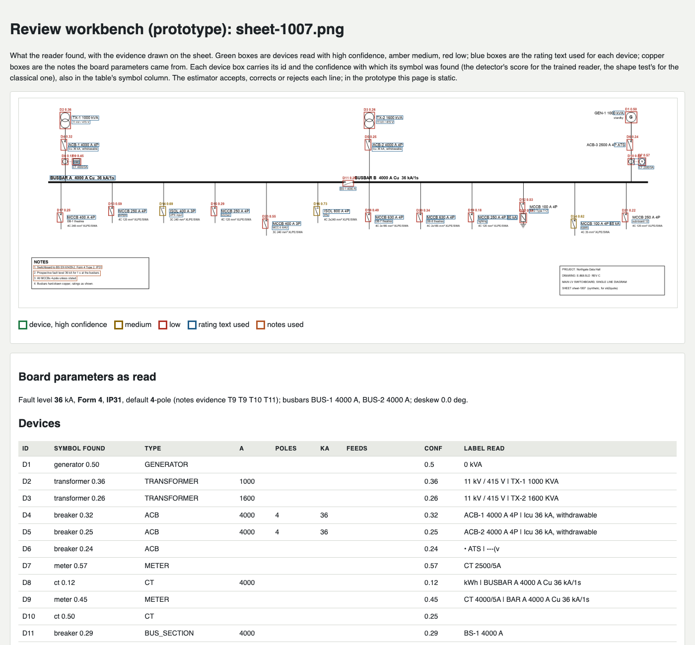
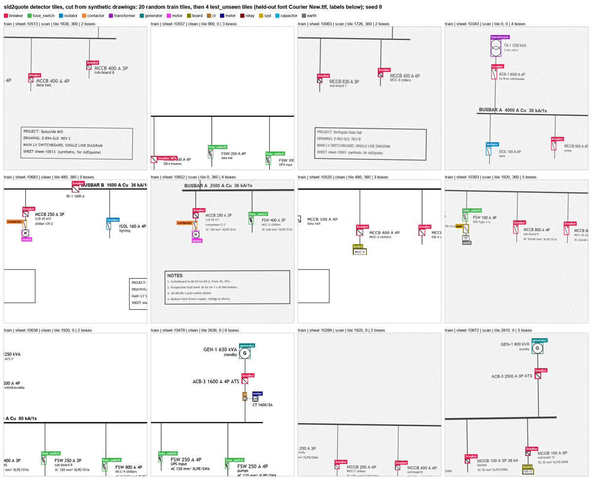

# sld2quote

**v0.2.0, 19 October 2026.** A miniature of the system the University of Salford and R&B Switchgear Knowledge Transfer
Partnership (KTP) sets out to build: it reads a low-voltage switchboard single-line diagram (SLD) and its specification,
builds a bill of materials with the evidence behind every line, prices it, writes a draft quotation for an estimator to
check, and measures every step against an answer key. It was built as evidence for a job application and is deliberately
small: every drawing it was trained and scored on is synthetic, drawn by its own generator; the catalogue, part
numbers and prices are invented; nothing in it comes from R&B.

Live demo: <Space URL>


*The review page (`review.html`) for a synthetic drawing the detector never saw (`sheet-1007`, trained reader): each
device box with the detector's score, the rating text used (blue) and the notes used (copper). The device table continues
below it, then the bill of materials with the evidence for each line, and the issues raised for the estimator.*

## What it does

1. **Draws** a synthetic switchboard SLD with IEC 60617 symbols for the devices an estimator prices (breakers in two drawn
   styles, fuse switches, isolators, motor starters, power-factor correction, surge protection, metering, downstream
   boards), in varied fonts, sizes and layouts, with a scan-like copy, its answer key, and a short specification that
   sometimes conflicts with the drawing on purpose (`sld2quote/generate.py`).
2. **Finds the symbols** with an RT-DETR detector fine-tuned on synthetic drawings, reading the page in overlapping tiles
   and merging them (`reader_v2.py`); the classical shape tests it replaced are kept as the baseline (`reader.py`).
3. **Reads the text** with Apple Vision on a Mac or RapidOCR anywhere (`ocr.py`), finds the busbars and lines, attaches
   each label to its device by rules, and reads the notes block: form, IP rating, fault level, poles (`reader.py`).
4. **Reads the specification** clause by clause and lists where it conflicts with the drawing, citing the clause
   (`spec.py`).
5. **Prices** with deterministic rules over the invented catalogue: every line names the symbol, text or clause it rests
   on, and anything doubtful is raised for the estimator, never silently fixed (`rules.py`, `catalogue.json`); then writes
   `quotation.md`, `bom.csv` and `review.html` (`quote.py`).
6. **Measures** symbols, ratings, notes, conflicts, bill-of-materials lines and price against the answer key
   (`evaluate.py`), and the detector and the text readers on their own (`train_detector.py eval`, `evaluate_ocr.py`).

## Results

Every result figure in this README is copied by a script from the files the evaluations wrote, not typed by hand:
[`eval/RESULTS.md`](eval/RESULTS.md) (every set, reader, device type and sheet), [`eval/DETECTOR.md`](eval/DETECTOR.md)
(every training run, per class) and [`eval/OCR.md`](eval/OCR.md) (every engine). Synthetic drawings only.

### Whole drawings: classical against trained reader

| Measure | Reader | Test, clean (30) | Test, scan-like (30) | Unseen style, clean (60) | Unseen style, scan-like (60) |
|---|---|---|---|---|---|
| Symbol precision | classical | 0.238 | 0.240 | 0.428 | 0.251 |
|  | trained | 0.967 | 0.945 | 0.956 | 0.850 |
| Symbol recall | classical | 0.059 | 0.079 | 0.133 | 0.100 |
|  | trained | 0.954 | 0.871 | 0.963 | 0.801 |
| Price error, mean | classical | 0.833 | 0.751 | 0.727 | 0.624 |
|  | trained | 0.312 | 0.369 | 0.241 | 0.304 |

Measured by `python3 -m sld2quote.evaluate` on 18 October 2026 on a Mac, with Apple Vision reading the text and the
detector on 4 CPU threads. *Test* is 30 drawings in the styles the detector trained on, none of which it
saw in training, each as a clean and a scan-like copy; *unseen style* is 60 drawings in styles held out of
training (the font Courier New, or labels below the symbols). A symbol counts as found when its device type is right and
its box overlaps the answer key's by IoU 0.3 or more. Price error is the gap between the quoted total and the total the
same rules give on the answer key, as a share of that total, so it measures reading, not pricing. Trained reader:
`weights/rtdetr_r18_full` at score threshold 0.11, chosen on whole validation drawings. The live site reads text with
RapidOCR, so its scores can differ from these.

### The detector on its own, per tile

| Set | Tiles | mAP@0.5 | Mean precision | Mean recall |
|---|---|---|---|---|
| Test, clean | 348 | 0.939 | 0.956 | 0.906 |
| Test, scan-like | 348 | 0.840 | 0.971 | 0.795 |
| Unseen style | 1,140 | 0.922 | 0.932 | 0.880 |

From the `rtdetr_r18_full` section of `eval/DETECTOR.md` (committed 18 October 2026): RT-DETR r18vd on 640 px tiles with
duplicate suppression, at the threshold chosen on validation tiles (0.10), mAP@0.5 from pycocotools. A symbol cut
by a tile edge counts as missed in that tile, although the reader can find it whole in a neighbouring one, so these are a
floor. Against the project's bar of 0.95 precision and recall for every class on both validation and unseen-style
tiles, 3 of 14 classes pass (fuse switch, transformer, generator);
furthest off on unseen-style tiles: capacitor, earth, downstream board, relay.


*Training tiles cut from synthetic drawings, with their answer-key boxes (the top of `data/coco/contact_sheet.png`, which
the export writes for checking by eye).*

### Text readers

| Engine | Sheets | Labels and notes, page pass | Labels, close-up pass | Seconds per standard sheet, page pass |
|---|---|---|---|---|
| RapidOCR, English recogniser (Linux, live site) | 60 | 0.960 | 0.914 | 2.51 |
| Apple Vision (Mac default) | 60 | 0.868 | 0.953 | 0.46 |
| Tesseract | 60 | 0.868 | 0.820 | 0.59 |
| docTR | 60 | 0.727 | 0.907 | 4.23 |
| EasyOCR | 10 | 0.732 | 0.876 | 32.03 |

From `eval/OCR.md`, measured on 18 October 2026 by `python3 -m sld2quote.evaluate_ocr` on the baseline sheets (clean and
scan-like) against the generator's own text: character accuracy on the rating labels and the notes lines, a string the
engine misses scoring 0, and wall time on 2 CPU threads (Vision's threads are set by macOS). RapidOCR is the engine on
Linux and on the live site. Apple Vision is still the Mac default: in the reader's close-up pass around each symbol it
reads labels better than RapidOCR (fourth column).

## Where it fails, and what remains

From the per-type tables in `eval/RESULTS.md` and the causes recorded in [`docs/PROBLEMS.md`](docs/PROBLEMS.md):

- **Labels go to the wrong device.** The trained reader has the rating right on 66.9 to 70.5 percent of the devices it
  finds. On a probe, most wrong ratings were labels read correctly but attached to the wrong device, and kW and kVAr
  ratings (contactors, motors, capacitors) are not parsed yet. After the symbols, this link is the next error source
  (PROBLEMS 13 and 20).
- **Scans.** Recall falls on scan-like copies, in the detector itself (second table) and after it: the blurred borders of
  the notes box and title block pass the busbar finder, the wrong band becomes the main busbar, and feeders are typed as
  incomers (PROBLEMS 14).
- **Role rules written for one symbol style.** The IEC bus-section symbol sits a few pixels off the busbar, outside the
  rule's tolerance, so many are typed as incoming breakers (PROBLEMS 14).
- **Rare and small symbols.** Relays, capacitors, surge arresters and earths have the fewest training examples and miss
  the bar; per-type results also swing from one training pass to the next, and a wider font set left the rarest, the
  relay, unlearned (PROBLEMS 10 to 10c).
- **Ghost parts on blank paper** at low thresholds, now held down by choosing the threshold on whole validation drawings,
  never per tile (PROBLEMS 10b).
- **Speed.** The trained reader takes 9.2 to 11.3 s a drawing on 4 CPU threads, most of it text reading, chiefly the
  close-up pass around each symbol (PROBLEMS 19).
- **Training numerics.** Every model so far, this one included, was trained on the Mac GPU through a fault that computed
  some weight gradients wrongly; the trainer now works around it, but this model is not yet retrained with the fix
  (PROBLEMS 17a).
- **Real drawings** use American ANSI/IEEE 315 symbols, which the detector has never seen; they are not labelled or scored
  yet (see below).

Not done in 0.2.0: the full symbol-to-label rule agreed on 17 October (symbols on one vertical line form a way, the way
owns its label block, each line goes to a device by what it says) with its own precision and recall; the scorecard of
failures by cause; hand labels and scores for the real drawings; the speed benchmark on the live site's server; a retrain
with the gradient fix and weight averaging, judged on whole drawings. The plan and every result so far, dated, are in [`HANDOFF.md`](HANDOFF.md) section 7.

## Run it

Python 3.12; `site/requirements.txt` pins the versions tested (on macOS; on Linux without a GPU, install torch from the
CPU index first, as its header says).

```sh
git clone https://github.com/CaptiveON/sld2quote && cd sld2quote
python3 -m pip install -r site/requirements.txt   # the pipeline, both readers, RapidOCR and the site
python3 -c "from huggingface_hub import snapshot_download; snapshot_download('itsmoadnan/sld2quote-detector', local_dir='weights/rtdetr_r18_full')"
./run_demo.sh
```

`run_demo.sh` builds the Apple Vision text tool on a Mac (`ocr/ocr.swift`, needs the Xcode command-line tools), draws
three synthetic sheets with their scan-like copies into `data/demo`, quotes one with the trained reader (or, with a note,
the classical one when the weights are missing) and prints where the outputs are.

One sheet:

```sh
python3 -m sld2quote.cli run data/demo/sheet-0002-scan.png --reader trained --device cpu
# writes out/sheet-0002-scan/: quotation.md, bom.csv, bom.json, review.html, extraction.json, spec_check.json
```

`--spec` names the specification (by default the `-spec.txt` beside a generated sheet; without one the cross-check is
skipped), `--out` the output folder, `--weights` the detector, `--device` cpu or mps (default mps when available). Any PNG
can be read, but the detector knows only the synthetic IEC style.

**Text reader on Linux.** With no Vision tool the reader uses RapidOCR, installed above; its OpenCV needs
`sudo apt-get install libgl1 libglib2.0-0`, and its English recogniser (9 MB) is fetched once from the Hugging Face hub.
`SLD2QUOTE_OCR=rapidocr` picks it on a Mac too, `SLD2QUOTE_OCR=vision` the Mac engine.

**The site.** `uvicorn app:app --app-dir site --port 7860` serves it at http://localhost:7860, live runs included
(`site/app.py`); `site/Dockerfile` builds the Space's image.

**Evaluation.** Each run rewrites only its own section of `eval/RESULTS.md`; `OMP_NUM_THREADS=4` gives the thread count
used above.

```sh
python3 sld2quote/generate.py --out data/baseline --n 30 --seed 100 --scan                  # 30 drawings, clean and scan-like
python3 -m sld2quote.evaluate --data data/baseline --out eval                                # classical reader
python3 -m sld2quote.evaluate --data data/baseline --out eval --reader trained --device cpu  # trained reader

# the test and unseen-style sets come from the training pool and its export
python3 sld2quote/generate.py --out data/pool --n 900 --seed 10000 --scan
python3 -m sld2quote.export_coco --pool data/pool --out data/coco --unseen 60 --val-unseen 20
python3 -m sld2quote.evaluate --make-sets                     # data/eval/test, unseen, val and val_unseen
python3 -m sld2quote.evaluate --data data/eval/test --out eval --reader trained --device cpu
python3 -m sld2quote.evaluate --data data/eval/unseen --out eval --reader trained --device cpu
python3 -m pip install pycocotools==2.0.11                    # the detector per tile (eval/DETECTOR.md)
python3 -m sld2quote.train_detector eval --weights weights/rtdetr_r18_full --data data/coco --split test_unseen --nms-iou 0.5 --device cpu
python3 -m sld2quote.evaluate_ocr --data data/baseline --engines vision,rapidocr --crops    # eval/OCR.md

python3 -m pip install pytest && python3 -m pytest -q tests   # tests needing absent weights, hub models or OCR engines skip
```

## The trained model

The detector is RT-DETR with the r18vd backbone, fine-tuned from `PekingU/rtdetr_r18vd` on tiles cut from synthetic
drawings, with its operating thresholds stored in its `config.json`. The weights are not kept in git: they are in the
Hugging Face model repository [itsmoadnan/sld2quote-detector](https://huggingface.co/itsmoadnan/sld2quote-detector) (the
download line above puts them in `weights/rtdetr_r18_full`, where the reader looks by default) and attached to the GitHub
release: <release asset URL>.

To train it again on a Mac GPU, with the data built as under Evaluation (the first command is the one recorded for this
model, with a new output folder; the second chooses its threshold on whole validation drawings):

```sh
PYTORCH_ENABLE_MPS_FALLBACK=1 python3 -m sld2quote.train_detector train --data data/coco --out weights/rtdetr_r18_new \
  --model PekingU/rtdetr_r18vd --epochs 10 --batch 16 --lr 1e-4 --backbone-lr 1e-5 --weight-decay 1e-4 --warmup-steps 300 \
  --grad-clip 0.1 --patience 3 --min-delta 0.002 --eval-every 1 --nms-iou 0.5 --device mps --seed 0 --time-budget-min 330
python3 -m sld2quote.select_threshold --weights weights/rtdetr_r18_new --sets data/eval/val,data/eval/val_unseen --device cpu
```

Training on the Mac GPU is seeded but not bit-for-bit repeatable, so a rerun gives a close model, not the same one.

## How the KTP would replace each part

| Here | In the KTP |
|---|---|
| Synthetic generator and answer keys | R&B's drawings labelled in a review tool, and a generator seeded with their real board topologies |
| RT-DETR detector trained on synthetic tiles | The same detector retrained on labelled R&B drawings, behind the same interface |
| Apple Vision or RapidOCR | Whichever engine measures best on R&B's drawings, run inside the company's boundary |
| Label linking by rules | A learned link model trained on estimators' corrections, and joins to schedule tables |
| Specification reader by rules | An LLM extractor with a fixed schema that cites the clause for every field |
| Invented catalogue and rules | R&B's design rules and supplier catalogues |
| Static review page | The estimator's workbench, where every correction becomes training data |
| Evaluation on synthetic sets | A golden set of real drawings and a regression gate on every model change |

## Real test set

`data/real/` holds 19 genuine one-line diagrams from 8 US federal documents (Unified Facilities Criteria, Army
technical manuals, the VA electrical design manual and a NAVFAC manual), public domain as works of the US government
(17 U.S.C. 105). [`data/real/SOURCES.md`](data/real/SOURCES.md) records each sheet's document, URL, page and the rights statement found, what was
excluded and why, and the doubts; `manifest.json` holds the render settings and image hashes. They are for scoring only,
never for training. They are not labelled yet, so no score is reported; they use American ANSI/IEEE 315 symbols, which
the detector has never seen.

## Attribution

- Symbol artwork in `assets/symbols/` (breaker, disconnector, current transformer, earth, protection relay, capacitor,
  surge arrester): IEC 60617 symbols from the QElectroTech elements library (https://qelectrotech.org/, by the
  QElectroTech team and contributors), licensed CC BY 3.0, taken unchanged from
  [synergycodes/ng-diagram-single-line-diagram](https://github.com/synergycodes/ng-diagram-single-line-diagram); details
  in [`assets/symbols/ATTRIBUTION.md`](assets/symbols/ATTRIBUTION.md).
- RT-DETR (Zhao et al., "DETRs Beat YOLOs on Real-time Object Detection", CVPR 2024;
  https://github.com/lyuwenyu/RT-DETR), Apache-2.0: the pretrained `PekingU/rtdetr_r18vd` weights, used through Hugging
  Face `transformers` (Apache-2.0). The trainer's weight averaging follows the authors' recipe.
- RapidOCR (https://github.com/RapidAI/RapidOCR), Apache-2.0, running PaddleOCR's PP-OCR models (Apache-2.0); the English
  recogniser comes from the `SWHL/RapidOCR` repository on the Hugging Face hub.
- The real drawings in `data/real/sheets/` come from US federal government documents and are in the public domain
  (17 U.S.C. 105); sources in `data/real/SOURCES.md`.

## Licence

MIT ([`LICENSE`](LICENSE)), copyright 2026 Muhammad Adnan. The symbol artwork in `assets/symbols/` keeps its CC BY 3.0 licence and
the drawings in `data/real/sheets/` are public domain; dependencies and downloaded models keep their own licences.

## AI assistance

Written with AI coding agents (Claude, by Anthropic) as implementation tools: they wrote the code, tests and documents
under the author's direction, and the author set the scope and the plan, took the decisions, set the acceptance tests and
reviewed the results. [CONFIRM wording with the author]

## More detail

- [`HANDOFF.md`](HANDOFF.md): the build record, with every decision, step and result, dated.
- [`docs/PROBLEMS.md`](docs/PROBLEMS.md): every real problem met, why it happened, what was done, and what it means for the KTP.
- [`eval/`](eval/): the full results (`RESULTS.md`, `DETECTOR.md`, `OCR.md`).
- [`CHANGELOG.md`](CHANGELOG.md) and [`CITATION.cff`](CITATION.cff).
